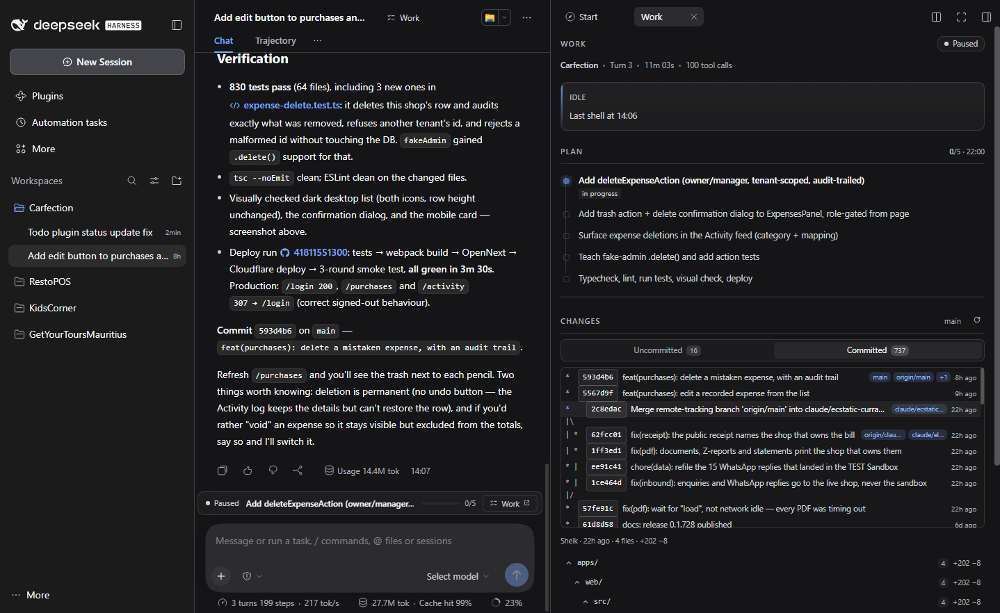

# Worklog

A live Work panel for the DeepSeek Harness Web UI. It answers two questions
while the agent works, without waiting for the final message:

1. **What is it doing right now, and how far into the plan is it?**
2. **What is uncommitted, and what changed in each commit?**

Open it from the **Work** button in the session header, from the strip above
the composer, or from the right Sidebar's add-tab guide (*Start → Work*).



## Why the shipped todo felt stuck

The `todos` projection the shipped todo strip reads is **cleared at every
`turn/start`**. So the moment the agent begins its next turn, the list is empty
again until the model happens to call `todo_write` — and between those calls
the strip keeps showing whatever step was last marked `in_progress`, even after
the agent has moved on.

Worklog addresses that on three levels:

- **It never drops a plan.** The last non-empty plan is retained for the page
  session; a cleared projection falls back to it. A genuinely empty list
  (`[]`) still clears it.
- **It shows the evidence next to the step.** The panel derives the live state
  from the Chat snapshot: the running tool call (with its target and elapsed
  time), the latest reasoning excerpt, the current turn/step, and the tool-call
  count.
- **It tells the agent how to report.** A small system-prompt section asks for
  a plan before multi-step work, a todo update at *every* step boundary, and a
  closing report of changes + verification + commit.

## What the panel shows

| Section | Source |
|---|---|
| **Now** — running tool or thinking, target, live timer, reasoning excerpt | `useChat` snapshot (`runningCalls`, `partial`) |
| **Plan** — every step with done / in progress / next markers, progress bar, last-updated clock | `useProjection('todos')`, retained across turns |
| **Changes** — `Uncommitted` and `Committed`, with the git graph and per-file line comparisons | Host git bridge (below) |

### Changes

The section has two tabs:

- **Uncommitted** — the working tree (`git status` + `git diff HEAD --numstat`),
  each file with an `A`/`M`/`D` badge and its `+added −deleted` counts.
- **Committed** — the **git commit graph**: git's own lane art (`git log
  --graph --decorate`), one selectable row per commit with its short hash, ref
  badges, subject, author and age. Merge connectors (`|\`, `|/`) are drawn as
  their own rows, so branches and merges read as a tree. Picking a row loads
  that commit's file list and line totals below it.

Both file lists are a **directory tree**: each folder collapses, shows how many
files sit under it, and carries their combined `+added −deleted`. Files nest
under their folders, so `apps/web/src/features/purchases/…` reads as a path
instead of one long line.

Any file row expands to the actual comparison: hunk headers, context lines,
green additions, red deletions. Comparisons are capped (1,200 lines, 340 px tall,
scrollable inside) so a 60 KB new file cannot take over the panel; the header
shows the branch plus `↑ahead ↓behind`.

When the directory is not a git repository (or git is unavailable), the section
falls back to the files this session wrote through its file tools, and says so.

## The dock strip

The plugin registers into `conversation.input.dock` with the shipped `todo`
id, so it **replaces** the old todo strip rather than stacking a second one:

```
● Working   Wire the edit dialog — Shell · npm run test     ▰▰▰▱▱ 2/4   [Work]
```

It updates on every streamed event and opens the full panel in one click.

## The git bridge

The Changes view needs real git data, so the Host half serves four read-only
routes inside the authenticated same-origin fetch fence (the same fence
`/api/changes.*` uses). Every command runs through `execFile('git', argv)` with
no shell, a 15 s timeout, and argv paths — never interpolated strings.

| Route | Answers |
|---|---|
| `/api/worklog.overview?cwd=` | branch, HEAD, ahead/behind, working-tree files with counts, recent commits |
| `/api/worklog.graph?cwd=&limit=` | the commit graph: lane art interleaved with commit rows (`--graph --decorate`) |
| `/api/worklog.commit?cwd=&hash=` | one commit's metadata and file list (`-m --first-parent`, so merges show their changes) |
| `/api/worklog.diff?cwd=&scope=&hash=&path=` | one file's hunks (worktree vs HEAD, or inside one commit) |

The browser names its own session's `cwd`; the Host accepts only an absolute
existing directory and fails closed (non-repository directories answer
`{ git: false }`).

## Prompt guidance

`index.js` registers one system-prompt section at order `10150` (after the
first-party guidance, before the persona suffix). It is deliberately short
because it repeats on every request. Disable it while keeping the panel:

```yaml
- id: worklog
  name: '@local/worklog'
  config:
    guidance: false
```

## Install state

The plugin is installed into the desktop profile as a linked bundle:

```jsonc
// ~/.dsh/profiles/desktop/package.json
"dependencies": { "@local/worklog": "link:C:/Projects/Carfection/plugins/worklog" },
"dsh": { "profile": { "bundles": [ ..., "@local/worklog" ] } }
```

The bundle's own `cordis.patch.yml` inserts the plugin. Installing a new bundle
or changing the Host half changes the Host's plugin tree, so **restart DeepSeek
Harness once** after those changes; a window reload only re-fetches the client
(which is enough for `src/`-only edits).

## Source layout

```text
plugins/worklog
  package.json          bundle manifest, client entry, display resources
  cordis.patch.yml      inserts the Host row
  index.js              Host half: prompt guidance + the git routes
  client.js             compiled loader artifact served to the page
  icon.svg
  locale/en.json
  src/
    entry.jsx           slot + tab registrations, open-the-panel helper
    run.js              pure derivation: plan, now, activity, changes, commit
    git.js              authenticated fetch helpers for the git bridge
    ui.jsx              Work panel, changes view, dock strip, header button
    css.js              scoped styles under .wl-
  scripts/
    build.mjs           esbuild wrapper for client.js
    test-run.mjs        fixture assertions for run.js
```

Rebuild after editing `src/`:

```powershell
cd C:\Projects\Carfection
node plugins\worklog\scripts\build.mjs
node plugins\worklog\scripts\test-run.mjs
```

`client.js` is read from disk per request, so a window reload picks up a
rebuild without restarting the Host.

## Limits worth knowing

- **Plan retention is per page load.** After a reload, a plan that the Host
  projection has already cleared is not reconstructed; it reappears the next
  time the agent writes the list.
- **The git bridge reads the session's working directory only.** A repository
  opened elsewhere on disk is not listed.
- **Comparisons are bounded.** Very large files and diffs are truncated with a
  visible notice rather than freezing the panel.
- **No writes.** The panel is read-only: it never stages, commits, edits todos,
  or changes the session.
